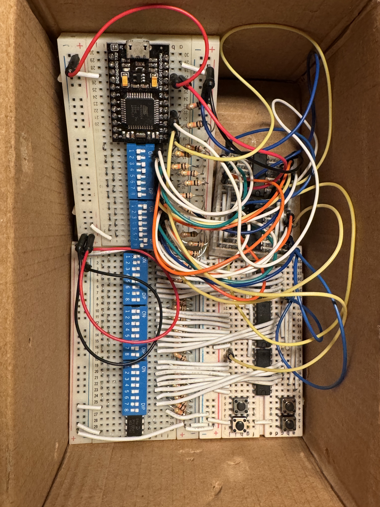

# Big Dipper

I built a hardware sequencer out of DIP switches in 2018. After a move across the country, this is all that remains:

I found my old notes in the box, so I immortalized this cursed design in software.

Presenting: [Big Dipper](https://rileyjshaw.com/big-dipper)

You can control Big Dipper with your mouse and/or keyboard.

| Key                     | Action                                                                                                  |
| ----------------------- | ------------------------------------------------------------------------------------------------------- |
| **↑** **↓** **←** **→** | Move focus between bytes                                                                                |
| **b**                   | Decrease selected byte value                                                                            |
| **g**                   | Increase selected byte value                                                                            |
| **c**                   | Copy selected byte (tap); copy instrument settings/notes (hold ~500ms); copy entire row (long hold ~2s) |
| **v**                   | Paste                                                                                                   |
| **0**, **z**            | Set byte to 0 (tap); zero settings or note bytes in row (hold)                                          |
| **9**, **a**            | Set byte to 255 (tap); set settings or note bytes in row to 255 (hold)                                  |
| **r**                   | Random value for selected byte                                                                          |
| **t**                   | Invert bits of selected byte                                                                            |
| **1**–**8**             | Toggle bit 1–8 of selected byte                                                                         |
| **?**                   | Show/hide switch labels (also available through the **?** button)                                       |

Hover or focus a switch to see its function and current value. The line below the numbers marks all switches that control that value. Labels follow the selected mode and settings; **Escape** dismisses the current tooltip. Your show/hide preference is remembered in this browser. Switch names and descriptions remain available to screen readers when visual labels are hidden.

See [the switch reference](docs/switches.md) for the complete bit mapping.

## About

The observable universe has about 1,000,000,000,000,000,000,000,000 stars. A group of 10 of these switches has nearly the same number of possible configurations. How many possible configurations exist with nine rows hooked together? Let’s put it like this. Imagine each star in our universe contains its own universe full of stars. And in each one of those sub-universes, each star contains a universe full of stars… and so on, to a depth of 5 layers. We’re getting closer, but we’re still a factor of 10 billion short.

This machine is full of almost limitless songs. Your job is to discover them 💫
